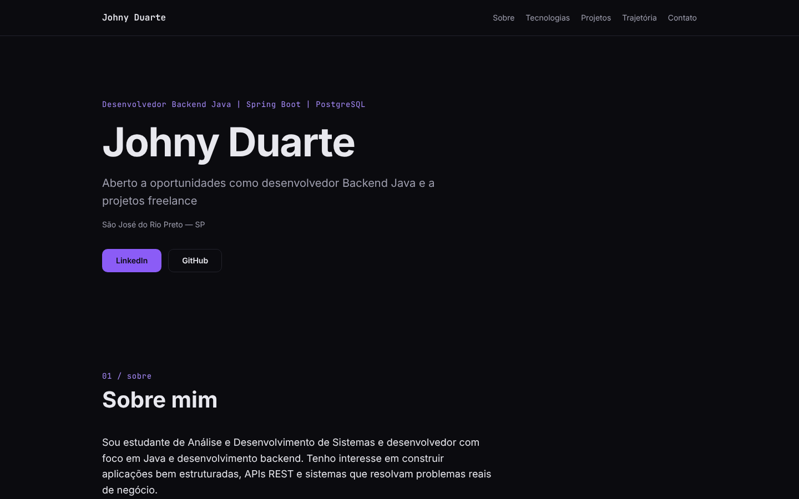

# Portfólio — Johny Duarte

Portfólio profissional de **Johny Duarte**, Desenvolvedor Backend Java. Apresenta
perfil, tecnologias, projetos e trajetória, com contato por LinkedIn, GitHub e
Instagram. O objetivo é mostrar o trabalho e conquistar tanto uma vaga de
desenvolvedor backend Java quanto projetos freelance.



## Stack

- [Vite](https://vite.dev) + [React](https://react.dev) + TypeScript (`strict`, sem `any`)
- CSS Modules com _design tokens_ em CSS (`src/styles/tokens.css`)
- Fontes servidas pelo próprio site (`@fontsource`), sem CDN
- Vitest + Testing Library + vitest-axe (testes e acessibilidade)
- ESLint + Prettier
- Docker (build em duas etapas) + nginx, publicado no Railway

É uma SPA estática: não há back-end, rotas nem formulário.

## Estrutura

```
src/
  data/                 conteúdo tipado (perfil, tecnologias, projetos, trajetória)
  types/                tipos do conteúdo
  components/ui/        Button, Tag, Card, SectionTitle
  components/layout/    Header, Footer, Section
  sections/             Hero, About, Skills, Projects, Timeline, Contact
  styles/               tokens.css (Design System) e global.css
config/                 plugin do Vite que resolve VITE_SITE_URL
nginx/                  template de configuração e cabeçalhos de segurança
scripts/                verify-container.sh (verificação da imagem Docker)
```

Para adicionar um projeto, edite apenas `src/data/projects.ts`.

## Como rodar

Requer Node.js 22 ou superior.

```bash
npm install
npm run dev        # servidor de desenvolvimento
npm test           # testes (Vitest)
npm run lint       # ESLint
npm run format     # Prettier
```

### Build de produção

```bash
VITE_SITE_URL=https://seu-dominio.exemplo npm run build
npm run preview
```

O build falha se `VITE_SITE_URL` não for informada ou não for uma URL `https`.

## Container

```bash
docker build --build-arg VITE_SITE_URL=https://seu-dominio.exemplo -t portfolio .
docker run --rm -e PORT=8080 -p 8080:8080 portfolio
```

O nginx escuta na porta definida em `PORT` (padrão `8080`). Para validar a
imagem (cabeçalhos de segurança, cache, gzip e fallback da SPA):

```bash
scripts/verify-container.sh
```

## Variáveis de ambiente

| Variável        | Quando           | Descrição                                                               |
| --------------- | ---------------- | ----------------------------------------------------------------------- |
| `VITE_SITE_URL` | build            | URL pública `https` do site, usada em canonical, Open Graph e og:image. |
| `PORT`          | execução (nginx) | Porta em que o nginx escuta. O Railway define automaticamente.          |

## Publicação no Railway

1. Crie um serviço no Railway a partir deste repositório. O `Dockerfile` da raiz é detectado.
2. Em **Variables**, defina `VITE_SITE_URL` com o domínio do serviço (ex.: `https://portfolio-production.up.railway.app`).
3. Gere o domínio público em **Settings → Networking**.
4. A cada push na `main` o Railway faz o deploy automaticamente.

Se o domínio mudar, atualize `VITE_SITE_URL` e refaça o deploy, pois o valor é
embutido no build.

## Qualidade

- HTML semântico, navegação por teclado e contraste WCAG AA (verificado em teste).
- Política de segurança de conteúdo `default-src 'self'` aplicada pelo nginx.
- Animação limitada a um _fade-in_ sutil, desativado com `prefers-reduced-motion`.
- Lighthouse local: 100 em Performance, Acessibilidade, Boas práticas e SEO.
- CI no GitHub Actions: lint, testes e build a cada push e pull request.
